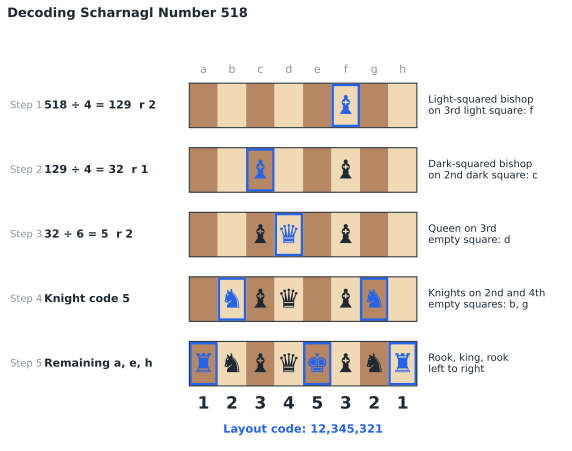
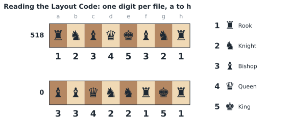
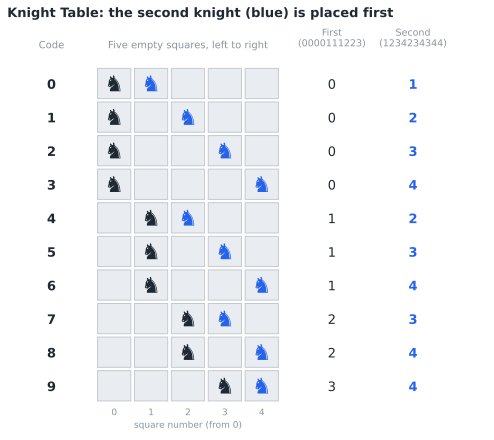
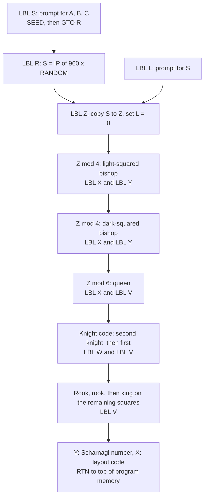

# CHESS960 Statefile

## CONTENTS

1. [Introduction](#1-introduction)
2. [Theory of Operations](#2-theory-of-operations)
3. [Variable Definitions](#3-variable-definitions)
4. [Program Descriptions](#4-program-descriptions)
5. [Operating Instructions](#5-operating-instructions)
6. [Example Calculations](#6-example-calculations)
7. [Quick Reference](#7-quick-reference)
8. [Program Listing](#8-program-listing)

---

## 1. INTRODUCTION

This program suite produces starting positions for Chess960 (Fischer Random Chess, now often called Freestyle Chess). In Chess960 the back-rank pieces are shuffled before each game, subject to two rules: the bishops must stand on opposite-colored squares, and the king must stand between the two rooks so that castling remains possible. Black mirrors White's setup. These rules allow exactly 960 starting positions.

### 1.1 Purpose

The program enables players to:

- Generate a random starting position, with all 960 positions equally likely
- Produce the starting position for any Scharnagl number from 0 to 959
- Recreate positions published in books, websites, and match reports
- Seed the random number generator from numbers supplied by both players, so that neither player controls the positions that come up

### 1.2 System Requirements

SwissMicros DM32 calculator with RPN operating system. Program requires 125 program steps in 10 labels. No equations, flags, or indirect registers are used.

### 1.3 Install and Download

Copy **CHESS960.d32** to the `/STATE` folder of the DM32's internal USB disk, then load it from the calculator. Instructions are available [via the DM32 User Manual](https://technical.swissmicros.com/dm32/doc/dm32_user_manual.html#_saving_and_loading_a_state).

---

## 2. THEORY OF OPERATIONS

### 2.1 Scharnagl Numbers

Reinhard Scharnagl devised the standard numbering of the 960 positions, 0 through 959. Because the scheme is standard, a given number refers to the same position in any book, website, or tournament. The traditional chess setup, RNBQKBNR, is position 518.

A Scharnagl number is not an arbitrary label. It encodes the square of each piece and can be decoded using only division and remainders.

The chart shows position 518 being decoded. Each step places one piece type; the new pieces are outlined in blue.



### 2.2 Key Equations

#### Decoding the Scharnagl Number

```
S ÷ 4   → remainder r₁ (0–3)   Light-squared bishop on b, d, f, h
q₁ ÷ 4  → remainder r₂ (0–3)   Dark-squared bishop on a, c, e, g
q₂ ÷ 6  → remainder r₃ (0–5)   Queen on empty square r₃ + 1
q₃      → knight code (0–9)    Two knights on the five empty squares
```

Where S is the Scharnagl number and q₁, q₂, q₃ are the successive quotients. The three remaining empty squares receive rook, king, rook, from left to right. The rooks and king add no further choices:

```
4 × 4 × 6 × 10 = 960
```

#### Layout Code

```
L = Σ (piece code × 10^(7 − f))
```

Where f is the file number, 0 for file a through 7 for file h. The layout is read as an 8-digit number from file a to file h, as White sees the board.

| Digit | Piece |
|-------|-------|
| **1** | Rook (R) |
| **2** | Knight (N) |
| **3** | Bishop (B) |
| **4** | Queen (Q) |
| **5** | King (K) |

The standard setup, RNBQKBNR, appears as **12345321**.



#### Random Layout

```
S = IP(960 × RANDOM)
```

#### Seed

```
SEED = FP(1000 × (A + B) ÷ C)
```

### 2.3 Knight Placement

The knight code from 0 to 9 selects one of the ten ways to place two knights on the five remaining empty squares. The program holds two lookup tables as constants, one digit per knight code:

| Knight code | 0 | 1 | 2 | 3 | 4 | 5 | 6 | 7 | 8 | 9 |
|-------------|---|---|---|---|---|---|---|---|---|---|
| First knight (`0000111223`) | 0 | 0 | 0 | 0 | 1 | 1 | 1 | 2 | 2 | 3 |
| Second knight (`1234234344`) | 1 | 2 | 3 | 4 | 2 | 3 | 4 | 3 | 4 | 4 |

Each entry is the knight's position among the five empty squares, counting from 0 at the left. The first table is keyed as `111223`; its leading zeros are implied. The second knight is placed first so that it does not shift the count for the first.



### 2.4 Program Logic Flow

The decoder (LBL Z) builds the layout in variable L, beginning from an empty board (L = 0). A square is empty when its digit in L is zero.



**Program Flow:**
1. Copy S to working register Z and set L = 0
2. Calculate Z mod 4 using XEQ X; place the light-squared bishop using XEQ Y
3. Calculate Z mod 4 using XEQ X; place the dark-squared bishop using XEQ Y
4. Calculate Z mod 6 using XEQ X; place the queen using XEQ V
5. Look up the second knight using XEQ W; place it using XEQ V
6. Look up the first knight using XEQ W; place it using XEQ V
7. Place a rook on the first empty square, a rook on the last empty square, and the king on the remaining square using XEQ V
8. Display results and return to the top of program memory

All 960 positions produced by this program have been verified against the standard Scharnagl numbering.

---

## 3. VARIABLE DEFINITIONS

| Variable | Description |
|----------|-------------|
| **A** | Player A's number (seed routine) |
| **B** | Player B's number (seed routine) |
| **C** | Referee constant, outside either player's control (seed routine) |
| **L** | Layout code, 8 digits, file a to file h |
| **S** | Scharnagl number, 0 to 959 |
| **W** | Empty-square counter (internal use) |
| **X** | Divisor (internal use) |
| **Y** | Current piece code (internal use) |
| **Z** | Working copy of S (internal use) |

---

## 4. PROGRAM DESCRIPTIONS

### 4.1 LBL R - Random Layout

Chooses a Scharnagl number at random, with all 960 positions equally likely, and decodes it into a layout. LBL R is the first label in program memory. Each run ends by returning to the top, so after the first game a new layout requires only **R/S**.

**Inputs:** None

**Outputs (Stack display from top to bottom):**
- Y: Scharnagl number
- X: Layout code

### 4.2 LBL L - Layout from a Known Number

Prompts for a Scharnagl number and decodes it into a layout. Use this to recreate a published position, or to let players choose a position by number.

**Inputs:** S (Scharnagl number)

**Outputs (Stack display from top to bottom):**
- Y: Scharnagl number
- X: Layout code

### 4.3 LBL S - Seed and Random Layout

Seeds the random number generator from three numbers, then runs LBL R. A and B are chosen by the players, ideally in private before they are revealed. C should be outside either player's control, such as the date.

**Inputs:** A (Player A's number), B (Player B's number), C (Referee constant)

**Outputs (Stack display from top to bottom):**
- Y: Scharnagl number
- X: Layout code

---

## 5. OPERATING INSTRUCTIONS

Set the display to FIX 0 (`DISP FX 0`) or ALL for the clearest view of the layout code.

### 5.1 Random Layout (LBL R)

**Procedure:**

1. Press `XEQ R`
2. For each further layout, press `R/S`

### 5.2 Layout from a Known Number (LBL L)

**Procedure:**

1. Press `XEQ L`
2. Enter the Scharnagl number when prompted (S?)

### 5.3 Seeded First Game (LBL S)

**Procedure:**

1. Press `XEQ S`
2. Enter player A's number when prompted (A?)
3. Enter player B's number when prompted (B?)
4. Enter the referee constant when prompted (C?)
5. For each further layout, press `R/S`. There is no need to reseed.

**Each program will display (from top to bottom on screen):**
- Y-register: Scharnagl number
- X-register: Layout code

Set up White's back rank from file a to file h, and mirror it for Black.

**Note:** The layout code is in the X-register. To view the Scharnagl number, press `x<>y`.

---

## 6. EXAMPLE CALCULATIONS

### 6.1 Standard Chess Setup

**Scenario:**

Confirm that Scharnagl number 518 produces the traditional chess setup.

**Solution:**

Press: `XEQ L`

| Prompt | Enter | Description |
|--------|-------|-------------|
| S? | 518 | Scharnagl number |

**Results (displayed on screen from top to bottom):**

| Register | Value | Meaning |
|----------|-------|---------|
| Y | 518 | Scharnagl number |
| X | 12,345,321 | R N B Q K B N R |

**Interpretation:**

Reading the layout code from file a to file h: Rook, Knight, Bishop, Queen, King, Bishop, Knight, Rook. Position 518 is the traditional chess setup.

The decoding proceeds as follows:

| Step | Operation | Remainder | Placement | Board (a–h) |
|------|-----------|-----------|-----------|-------------|
| 1 | 518 ÷ 4 = 129 | 2 | Light-squared bishop on f | `-----B--` |
| 2 | 129 ÷ 4 = 32 | 1 | Dark-squared bishop on c | `--B--B--` |
| 3 | 32 ÷ 6 = 5 | 2 | Queen on 3rd empty square, d | `--BQ-B--` |
| 4 | Knight code 5 | — | Knights on b and g | `-NBQ-BN-` |
| 5 | Remaining a, e, h | — | Rook, king, rook | `RNBQKBNR` |

### 6.2 Position 0

**Scenario:**

Produce the layout for Scharnagl number 0.

**Solution:**

Press: `XEQ L`

| Prompt | Enter | Description |
|--------|-------|-------------|
| S? | 0 | Scharnagl number |

**Results (displayed on screen from top to bottom):**

| Register | Value | Meaning |
|----------|-------|---------|
| Y | 0 | Scharnagl number |
| X | 33,422,151 | B B Q N N R K R |

**Interpretation:**

Both bishops occupy the queenside corner, on files a and b, on opposite-colored squares. The king stands on g, between the rooks on f and h.

### 6.3 Seeded First Game

**Scenario:**

Two players begin a match. Player A chooses 1987 and player B chooses 2003, each in private. The referee constant is the date, 10.122026.

**Solution:**

Press: `XEQ S`

| Prompt | Enter | Description |
|--------|-------|-------------|
| A? | 1987 | Player A's number |
| B? | 2003 | Player B's number |
| C? | 10.122026 | Referee constant |

**Results (displayed on screen from top to bottom):**

| Register | Value | Meaning |
|----------|-------|---------|
| Y | *S* | Scharnagl number |
| X | *L* | Layout code |

**Interpretation:**

The first game's layout is displayed. For each following game, press `R/S`.

---

## 7. QUICK REFERENCE

### 7.1 Program Labels

| Label | Function |
|-------|----------|
| **R** | Random layout |
| **L** | Layout from a known Scharnagl number |
| **S** | Seed, then random layout |
| **Z** | Decoder subroutine (internal) |
| **Y,X,W** | Bishop, divide, and knight table subroutines (internal) |
| **V,U,T** | Empty square placement and scan subroutines (internal) |

### 7.2 Typical Input Ranges

| Variable | Typical Range |
|----------|---------------|
| **S** | 0 to 959 (integers only) |
| **A** | Any number chosen by player A |
| **B** | Any number chosen by player B |
| **C** | Any nonzero number, such as the date |

### 7.3 Important Notes

- The layout code is read from file a to file h, as White sees the board; Black mirrors it
- The DM32 groups digits in the display, so 12345321 appears as 12,345,321; the commas are not part of the code
- No test is performed on the input to LBL L; a number outside 0 to 959, or with a fractional part, produces a meaningless layout
- C must not be zero
- Every run returns to the top of program memory, so pressing `R/S` after LBL L produces a random layout
- Labels and variables are separate on the DM32, so a label and a variable may share a letter

---

## 8. PROGRAM LISTING

The complete program listing is provided below. Program steps are shown in standard DM32 RPN format with label-relative line numbers, as displayed on the calculator. The DM32 does not generate checksums.

### LBL R - Random Layout

```
R01  LBL R       Random layout. Start of program memory.
R02  RANDOM      Random number, 0 ≤ x < 1.
R03  960
R04  ×
R05  IP          S = IP(960 × random), 0 to 959.
R06  STO S       Stores Scharnagl number S.
R07  GTO Z       Decodes S.
```

### LBL L - Layout from a Known Number

```
L01  LBL L       Layout from a known S.
L02  INPUT S     Prompts for Scharnagl number.
```

### LBL Z - Decoder Subroutine

```
Z01  LBL Z       Decodes S into layout L.
Z02  RCL S       Working copy of S in Z.
Z03  STO Z
Z04  0           Clears the board, L = 0.
Z05  STO L
Z06  4           Z mod 4: light-squared bishop.
Z07  XEQ X
Z08  6
Z09  XEQ Y       Places it on b, d, f, or h.
Z10  4           Z mod 4: dark-squared bishop.
Z11  XEQ X
Z12  7
Z13  XEQ Y       Places it on a, c, e, or g.
Z14  4           Piece code 4: queen.
Z15  STO Y
Z16  6           Z mod 6: queen's empty square.
Z17  XEQ X
Z18  XEQ V       Places queen. Z now 0 to 9.
Z19  2           Piece code 2: knight.
Z20  STO Y
Z21  1234234344  Knight table, second knight.
Z22  XEQ W       Reads digit for this Z.
Z23  XEQ V       Places second knight.
Z24  111223      Knight table, first knight
Z25  XEQ W       (leading zeros implied).
Z26  XEQ V       Places first knight.
Z27  1           Piece code 1: rook.
Z28  STO Y
Z29  0           Rook on 1st empty square.
Z30  XEQ V
Z31  1           Rook on 2nd (last) empty square.
Z32  XEQ V
Z33  5           Piece code 5: king.
Z34  STO Y
Z35  0           King on remaining square.
Z36  XEQ V
Z37  CLx         Clears stack.
Z38  ENTER
Z39  ENTER
Z40  RCL S       Y-register: Scharnagl number S.
Z41  RCL L       X-register: layout L.
Z42  RTN         Returns to top: R/S for next game.
```

### LBL Y - Bishop Placement Subroutine

```
Y01  LBL Y       Bishop placement subroutine.
Y02  x<>y        On entry: Y = r, X = exponent n.
Y03  2
Y04  ×
Y05  -           n − 2r.
Y06  10ˣ         Square value 10^(n − 2r).
Y07  3
Y08  ×           3 = bishop.
Y09  STO+ L      Adds bishop to L.
Y10  RTN
```

### LBL X - Divide and Remainder Subroutine

```
X01  LBL X       Divide-and-remainder subroutine.
X02  STO X       Stores divisor.
X03  RCL Z
X04  RCL÷ X
X05  IP
X06  RCL× X      Divisor × IP(Z ÷ divisor).
X07  RCL Z
X08  x<>y
X09  -           r = Z mod divisor.
X10  STO- Z      Z = Z − r.
X11  RCL X
X12  STO÷ Z      Z = Z ÷ divisor.
X13  R↓          Returns r in X.
X14  RTN
```

### LBL W - Knight Table Subroutine

```
W01  LBL W       Knight table lookup subroutine.
W02  10
W03  RCL- Z
W04  10ˣ         10^(10 − Z).
W05  ÷           Shifts table right.
W06  FP          Isolates remaining digits.
W07  10
W08  ×
W09  IP          Returns digit Z + 1 of table.
W10  RTN
```

### LBL V - Empty Square Placement Subroutine

```
V01  LBL V       Place piece on the (x+1)th empty
V02  1           square, counting from file a.
V03  +
V04  STO W       Stores empty-square counter.
V05  1E7         Square value of file a.
```

### LBL U - Square Scan Loop

```
U01  LBL U       Square scan loop.
U02  ENTER
U03  ENTER
U04  RCL L
U05  x<>y
U06  ÷
U07  IP          Digit of L at this square.
U08  10
U09  ÷
U10  FP          Digit ÷ 10.
U11  x≠0?        Square occupied?
U12  GTO T       If so, tries next square.
U13  DSE W       Counts down empty squares.
U14  GTO T       Not yet there: next square.
U15  +           Recovers square value.
U16  RCL× Y      × piece code.
U17  STO+ L      Adds piece to L.
U18  RTN
```

### LBL T - Next Square Subroutine

```
T01  LBL T       Next square subroutine.
T02  x<>y        Square value to X.
T03  10
T04  ÷           Moves one file to the right.
T05  GTO U       Continues scan.
```

### LBL S - Seed and Random Layout

```
S01  LBL S       Seed, then random layout.
S02  INPUT A     Prompts for player A's number.
S03  INPUT B     Prompts for player B's number.
S04  INPUT C     Prompts for referee constant.
S05  RCL A
S06  RCL+ B
S07  RCL÷ C      (A + B) ÷ C.
S08  1000
S09  ×
S10  FP          Fractional part of × 1000.
S11  SEED        Seeds the random number generator.
S12  GTO R       Runs a random layout.
```

---

## Acknowledgments

This program began as a port of Rudi's Chess960 program for the DM42. The DM42 version builds the layout in the alpha register, which the DM32 does not have, so the DM32 version was redesigned around Scharnagl's published numbering. The DM32 version was developed with AI assistance (Claude).

Thanks to the members of the [SwissMicros forum](https://forum.swissmicros.com) who tested the program and checked positions against [chess960.net](https://chess960.net/start-positions/).

### By jacober-calc for SwissMicros DM32

> - [SwissMicros Website](https://www.swissmicros.com)
> - [DM32 product page](https://www.swissmicros.com/product/model-dm32)
> - [SwissMicros full products page](https://www.swissmicros.com/products)
> - [DM32 Online User Manual](https://technical.swissmicros.com/dm32/doc/dm32_user_manual.html)
